# Linux for DevOps --- Beginner-Friendly Notes

> A practical Linux command guide for beginners preparing for AWS,
> Cloud, and DevOps.
>
> **Practice safely:** use a Linux VM, WSL, or a test EC2 instance. Be
> careful with `sudo`, `rm`, permissions, disks, and firewall commands.
> Examples that change the system are marked clearly.


### Diagram guide

Diagrams explain Linux architecture, the filesystem tree, file-reading choices,
`touch` behavior, user/group management, permissions, process and service troubleshooting,
network diagnosis, Bash script flow, redirection, and cron scheduling. GitHub renders the
`mermaid` code blocks as diagrams when viewing the Markdown file.


## Table of Contents

1.  [What is Linux?](#1-what-is-linux)
2.  [Terminal basics and command
    syntax](#2-terminal-basics-and-command-syntax)
3.  [Navigation](#3-navigation)
4.  [Create, copy, move, and remove
    files](#4-create-copy-move-and-remove-files)
5.  [Read and edit files: cat and
    friends](#5-read-and-edit-files-cat-and-friends)
6.  [File timestamps: touch and stat](#6-file-timestamps-touch-and-stat)
7.  [Search and text processing](#7-search-and-text-processing)
8.  [Users and groups](#8-users-and-groups)
9.  [Permissions and ownership](#9-permissions-and-ownership)
10. [Processes and jobs](#10-processes-and-jobs)
11. [Services and logs](#11-services-and-logs)
12. [Networking and SSH](#12-networking-and-ssh)
13. [Disk, memory, and system health](#13-disk-memory-and-system-health)
14. [Packages and software
    installation](#14-packages-and-software-installation)
15. [Bash scripting essentials](#15-bash-scripting-essentials)
16. [Environment variables, pipes, and
    redirection](#16-environment-variables-pipes-and-redirection)
17. [Scheduling with cron](#17-scheduling-with-cron)
18. [Common troubleshooting recipes](#18-common-troubleshooting-recipes)
19. [Safe practice lab](#19-safe-practice-lab)
20. [Quick command cheat sheet](#20-quick-command-cheat-sheet)

------------------------------------------------------------------------
### should know 
1.What is an operating system?
An operating system (OS) is software that helps you use a computer.
For example:
- Windows runs on your laptop.
- Android runs on many mobile phones.
- Linux is used on computers and servers.
The operating system helps applications use the computer's memory, processor, files, and other hardware.

2. What is the Linux kernel?
Think of a computer as a company.
- Hardware = the machines and equipment.
- Applications = the people doing different jobs.
- Linux kernel = the manager that helps applications use the hardware properly.
The Linux kernel is the core part of the operating system. It manages things like memory, running programs, and communication with hardware.
3. What is a Linux distribution?
The kernel alone isn't everything you need to comfortably use and manage a computer. You also need tools and other software.
A Linux distribution (or distro) combines the Linux kernel with those tools and software to provide a usable operating system.
Examples include:
- Ubuntu — commonly used on desktops, servers, and in learning.
- Debian — a Linux distribution known for stability.
- Amazon Linux — designed for use with Amazon Web Services (AWS).
- Red Hat Enterprise Linux (RHEL) — a Linux distribution used by businesses.

 Linux is the core software that manages a computer's resources. A Linux distribution combines the Linux kernel with other tools and software to give you a complete operating system.
 
## 1. What is Linux?

Linux is an operating-system kernel. Linux distributions such as Ubuntu,
Debian, Amazon Linux, and Red Hat Enterprise Linux combine the kernel
with system utilities, package managers, and other software.

### A simplified Linux architecture

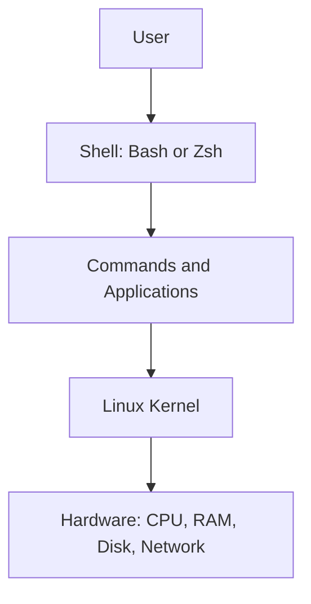

-   **Shell:** reads commands and starts programs.
-   **Kernel:** manages processes, memory, devices, and networking.
-   **Filesystem:** organizes files and directories.
-   **Distribution:** packages the kernel and software into a usable
    operating system.

### Linux filesystem tree

Linux uses one directory tree starting at `/`. Unlike Windows, it does
not normally use drive letters such as `C:`.

```text
/
├── home/       # Personal directories for regular users
├── root/       # Home directory of the root administrator
├── etc/        # System configuration
├── var/        # Frequently changing data, including many logs
├── tmp/        # Temporary files
├── usr/        # Applications, libraries, shared resources
├── bin/        # Essential command binaries (may link to /usr/bin)
├── sbin/       # System administration binaries (layout varies)
├── dev/        # Device files
├── proc/       # Virtual process/kernel information
├── sys/        # Virtual device/kernel information
├── boot/       # Boot files
└── mnt/        # Common temporary mount point
```

## 2. Terminal basics and command syntax

General form:

```bash
command [options] [arguments]
```

Example:

```bash
ls -l /var/log
```

-   `ls` is the command.
-   `-l` is an option requesting long-format output.
-   `/var/log` is the argument (the directory to list).

Useful basics:

```bash
whoami       # Current username
hostname     # Machine name
date         # Current date and time
cal          # Calendar, if installed
uname -a     # Kernel and system information
history      # Recent shell commands
clear        # Clear terminal display
man ls       # Manual for ls; press q to exit
ls --help    # Short help for many GNU commands
```

**Tip:** Linux commands and filenames are usually case-sensitive.
`File.txt` and `file.txt` can be different files.

## 3. Navigation

  Command     Purpose                                        Example
  ----------- ---------------------------------------------- -----------
  `pwd`       Print current directory                        `pwd`
  `ls`        List files                                     `ls`
  `ls -l`     Detailed listing                               `ls -l`
  `ls -a`     Include hidden names                           `ls -a`
  `ls -lh`    Human-readable sizes                           `ls -lh`
  `cd /etc`   Move to a directory                            `cd /etc`
  `cd ..`     Go up one level                                `cd ..`
  `cd ~`      Go to your home directory                      `cd ~`
  `cd -`      Return to previous directory                   `cd -`
  `tree`      Display directory tree (may need installing)   `tree .`

Path examples:

-   `/home/sam/notes.txt` is an **absolute path** because it starts with
    `/`.
-   `docs/notes.txt` is a **relative path** from the current directory.
-   `.` means current directory; `..` means parent directory; `~`
    usually means your home directory.

## 4. Create, copy, move, and remove files

### Create directories

```bash
mkdir practice
mkdir -p practice/linux/files
mkdir -p a/b/c          # Create nested directories
tree .                 # Display directory tree (install tree if needed)
```

`mkdir -p` creates missing parent directories and does not complain if
the requested directories already exist.

### Create empty files with `touch`

```bash
touch notes.txt
touch file1.txt file2.txt file3.txt
touch file{1..5}.txt
```

The brace expression `file{1..5}.txt` expands in Bash to `file1.txt`
through `file5.txt`.

### Copy and rename/move

```bash
cp notes.txt notes-backup.txt
cp notes.txt practice/
cp -r practice practice-backup
mv notes.txt linux-notes.txt
mv linux-notes.txt practice/
```

-   `cp` copies files.
-   `cp -r` copies a directory and its contents recursively.
-   `mv` moves or renames a file or directory.

### Remove files and directories

```bash
rm old-file.txt
rmdir empty-directory
rm -r practice-backup
```

**Safety:** `rm` usually does not move items to a recycle bin. Check the
path before running it. Avoid practicing destructive commands with
`sudo`. Never run an unfamiliar `rm -rf` command blindly.

### Wildcards

```bash
ls *.txt       # Names ending in .txt
ls file?.txt   # ? matches one character
touch log{1..3}.txt
```

A wildcard is expanded by the shell before the command runs.

## 5. Read and edit files: cat and friends

### `cat`: four common patterns

#### 1. Display a file

```bash
cat file.txt
```

Prints the entire file to the terminal. For very large files, prefer
`less`.

#### 2. Create or overwrite a file

```bash
cat > greeting.txt
```

Type the content, for example:

```text
Hello Linux
Learning DevOps
```

Press **Ctrl+D** on a new line to finish. The `>` redirection creates
the file or **overwrites existing content**.

You can also create a file using a here-document:

```bash
cat > greeting.txt <<'EOF'
Hello Linux
Learning DevOps
EOF
```

#### 3. Append to a file

```bash
cat >> greeting.txt
```

Type more text and press **Ctrl+D** on a new line. `>>` appends instead
of replacing the existing content.

Here-document version:

```bash
cat >> greeting.txt <<'EOF'
This line is appended.
EOF
```

#### 4. Combine multiple files

```bash
cat file1.txt file2.txt > combined.txt
```

This writes the contents of `file1.txt` followed by `file2.txt` into
`combined.txt`. If `combined.txt` already exists, it is overwritten.

### Visual: choosing a file-reading command

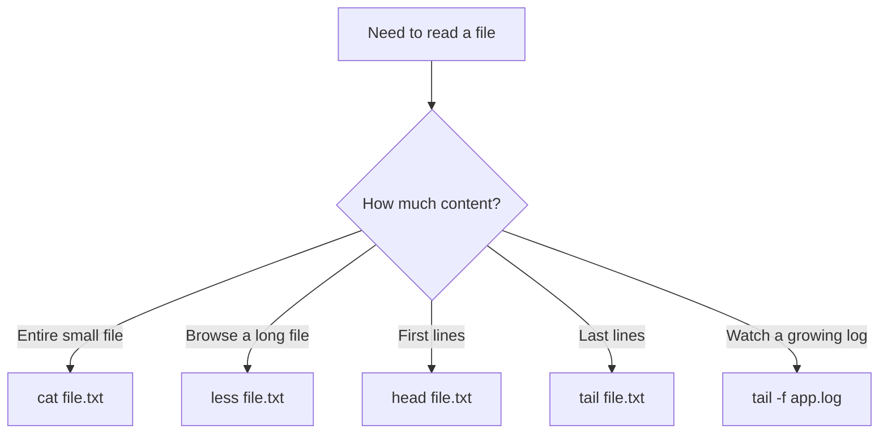


```bash
less /var/log/syslog     # Scroll through a file; press q to quit
head file.txt            # First 10 lines
head -n 5 file.txt       # First 5 lines
tail file.txt            # Last 10 lines
tail -n 30 file.txt      # Last 30 lines
tail -f app.log          # Follow new log lines live; Ctrl+C to stop
wc -l file.txt           # Count lines
nl -ba file.txt          # Show line numbers
```

The log filename varies by distribution; some systems use
`/var/log/messages` or the system journal instead of `/var/log/syslog`.

### Edit files

```bash
nano file.txt
vim file.txt
```

**Nano basics:** type to edit; `Ctrl+O` saves; press Enter to confirm
the filename; `Ctrl+X` exits.

- `Ctrl+W` --- search for text.
- `Ctrl+K` --- cut the current line.
- `Ctrl+U` --- paste the cut text back.

Nano shows common shortcuts at the bottom; `^` means the Ctrl key.

**Vim basics:**

-   `i` --- enter insert mode.
-   `Esc` --- return to normal mode.
-   `:w` --- save.
-   `:q` --- quit.
-   `:wq` --- save and quit.
-   `:q!` --- quit without saving changes.
-   `dd` --- delete the current line in normal mode.
-   `yy` --- copy (yank) the current line.
-   `p` --- paste after the cursor/current line.
-   `/word` --- search forward for `word`; press `n` for the next match.

Vim reminder: press `Esc` before entering commands such as `:wq` or `dd`.

## 6. File timestamps: touch and stat

### Visual: what `touch` does

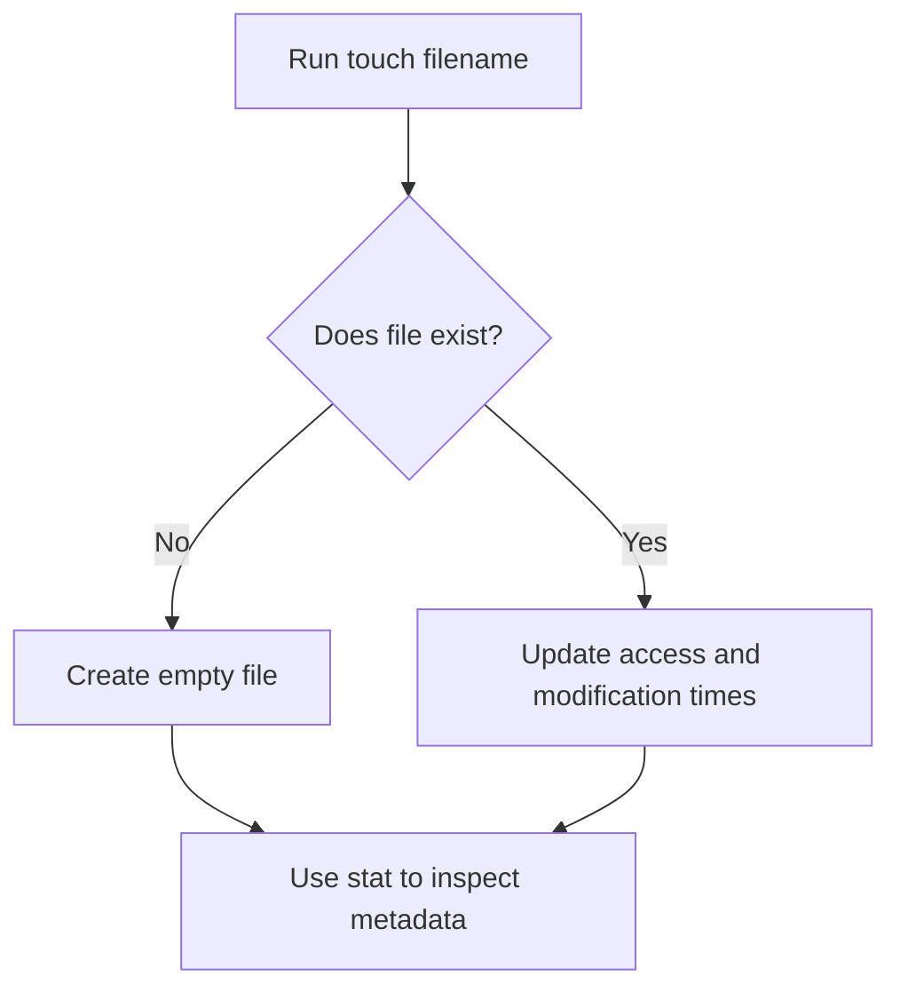


Linux files commonly expose three timestamps:

-   **atime (access time):** last access/read time, subject to
    filesystem mount policies.
-   **mtime (modification time):** last content modification time.
-   **ctime (change time):** last change to file metadata or inode
    status; it is **not** the file creation time.

### `touch` examples

```bash
touch report.txt
touch file1.txt file2.txt file3.txt   # Create/update multiple files
touch file{1..5}.txt                  # Bash brace expansion
```

Creates `report.txt` if it does not exist. If it exists, updates its
access and modification timestamps to the current time.

```bash
touch one.txt two.txt three.txt
touch file{1..5}.txt
touch -a report.txt       # Update access time only
touch -m report.txt       # Update modification time only
touch -c missing.txt      # Do not create a missing file
```

Set a specific timestamp using `[[CC]YY]MMDDhhmm[.ss]` format:

```bash
touch -t 202610091430 report.txt
```

This sets the timestamp to **2026-10-09 14:30** in the machine's local
time. Use `man touch` for the exact format supported by your system.

Inspect timestamps and metadata:

```bash
stat report.txt
stat -c 'Access: %x%nModify: %y%nChange: %z' report.txt  # GNU stat
```

Example output varies, but it includes file size, permissions, and
access/modify/change timestamps.

## 7. Search and text processing

### Find files and directories

```bash
find . -name "notes.txt"
find /var/log -type f -name "*.log"
find . -type d -name "backup"
find / -name "file.txt" 2>/dev/null  # Search from root; permission errors hidden
```

Searching from `/` can take time and may require elevated permissions. Prefer a narrower starting directory when possible.

-   `.` starts searching in the current directory.
-   `-type f` means regular files; `-type d` means directories.
-   Quote patterns such as `"*.log"` so `find` can evaluate them.

### Search text with `grep`

```bash
grep "ERROR" app.log
grep -i "error" app.log       # Case-insensitive
grep -n "ERROR" app.log       # Include line numbers
grep -r "TODO" ./project      # Search recursively
grep -E "ERROR|WARN" app.log  # Extended regular expression
```

### Combine commands

```bash
grep "ERROR" app.log | tail -n 20
```

The pipe `|` sends the output of the first command to the next command.

### Useful text-processing commands

```bash
sort names.txt
sort names.txt | uniq
cut -d: -f1 /etc/passwd
awk '{print $1}' file.txt
sed 's/old/new/g' file.txt
```

-   `sort` sorts lines.
-   `uniq` removes adjacent duplicate lines; use `sort file | uniq` to
    group duplicates first.
-   `cut` extracts delimited fields.
-   `awk` processes columns and records.
-   `sed` transforms text; the example prints replacements to the
    terminal without changing the original file.

### Count and inspect output

```bash
wc -l app.log
command > output.txt       # Save standard output, replacing file
command >> output.txt      # Append standard output
command 2> errors.txt      # Save error output
command > all.txt 2>&1     # Save standard output and errors together
```

## 8. Users and groups

### Visual: user and group relationship

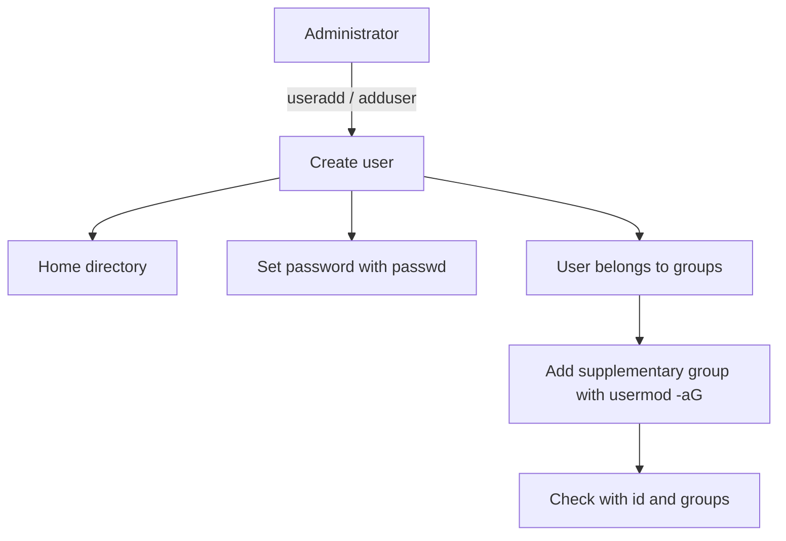


Linux users have numeric user IDs (UIDs). Groups have group IDs (GIDs).
A process runs with user/group permissions.

### Check the current user

```bash
whoami
id
id john
groups
groups john
```

### Create a user

On Ubuntu, `adduser` is an interactive helper and is often
beginner-friendly:

```bash
sudo adduser john
```

On many distributions, `useradd` is the lower-level command:

```bash
sudo useradd -m -s /bin/bash john
sudo passwd john
```

-   `sudo` runs a command with elevated privileges when permitted.
-   `useradd` creates the account.
-   `-m` creates a home directory, usually `/home/john`.
-   `-s /bin/bash` sets Bash as the login shell.
-   `passwd john` sets or changes the user's password.

The exact defaults can differ by distribution.

### Create multiple users

```bash
sudo useradd -m -s /bin/bash alice
sudo useradd -m -s /bin/bash bob
sudo passwd alice
sudo passwd bob
```

Use a test VM. Do not create accounts on a shared or production machine
unless authorized.

### Create and manage groups

```bash
sudo groupadd devops
sudo usermod -aG devops john
sudo usermod -aG devops alice
id john
groups alice
```

Important: `-aG` means **append** the user to supplementary groups.
Using `-G` without `-a` can replace the user's supplementary group list,
so do not omit `-a` accidentally.

The user may need to log out and log back in for a new group membership
to appear in an existing session.

### Switch users and remove accounts

```bash
su - john
sudo -iu john
```

Use `exit` to leave the switched shell. `sudo -iu john` is often
convenient for opening a login shell as another user when permitted.

Account removal is destructive and should only be practiced on a
disposable VM:

```bash
sudo userdel john
sudo userdel -r john
```

`-r` also attempts to remove the user's home directory and mail spool.
Confirm the target account and data before using it.

### Useful account files

-   `/etc/passwd` --- account details; normally does not store password
    hashes.
-   `/etc/shadow` --- protected password hashes and aging data.
-   `/etc/group` --- group information.

Do not publish real password hashes, private keys, tokens, or personal
system details in a public GitHub repository.

## 9. Permissions and ownership

### Visual: reading `rwx` permissions

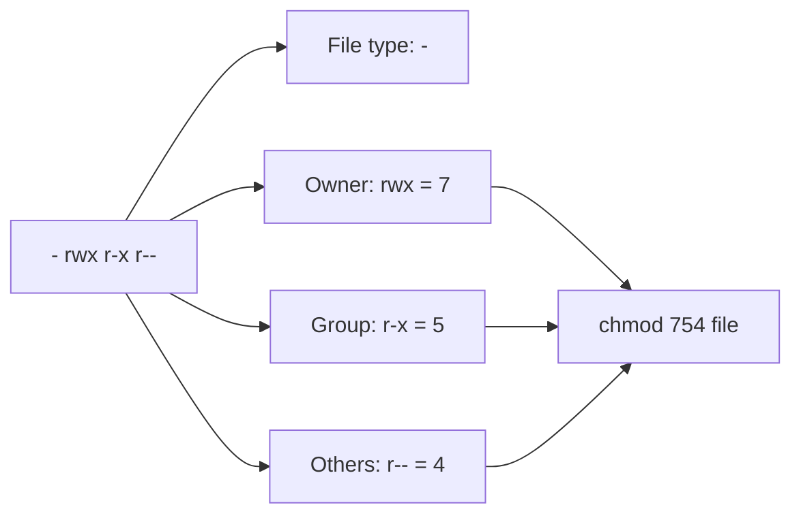


Run:

```bash
ls -l file.txt
```

Example:

```text
-rw-r--r-- 1 john devops 120 Oct 9 14:30 file.txt
```

Interpretation:

```text
- rw- r-- r--
│ │   │   └── Others: read
│ │   └────── Group: read
│ └────────── Owner: read and write
└──────────── Regular file
```

For a directory, `x` means you can traverse/search it. For files, `x`
means executable.

### Permission numbers

  Permission        Number Meaning
  --------------- -------- -------------------------------------------------
  Read (`r`)             4 Read file contents / list directory entries
  Write (`w`)            2 Change file contents / modify directory entries
  Execute (`x`)          1 Execute a file / traverse a directory

Add the numbers for each owner/group/other set:

-   `7` = `rwx` (4+2+1)
-   `6` = `rw-` (4+2)
-   `5` = `r-x` (4+1)
-   `4` = `r--`

Examples:

```bash
chmod 755 script.sh
chmod 644 notes.txt
chmod u+x script.sh
chmod g-w shared.txt
```

-   `755` means owner `rwx`, group `r-x`, others `r-x`.
-   `644` means owner `rw-`, group `r--`, others `r--`.
-   `u+x` adds execute permission for the owner.

Avoid `chmod 777` as a default fix. It grants everyone read, write, and
execute access, which is often unsafe.

### Ownership

```bash
sudo chown john file.txt
sudo chgrp devops file.txt
sudo chown john:devops file.txt
sudo chown -R john:devops project/
```

`-R` applies changes recursively; check the path carefully before using
it.

### `umask`

`umask` controls which permission bits are removed from default
permissions when new files and directories are created.

```bash
umask
umask -S
```

The common `umask 022` usually results in new files being `644` and
directories being `755`, assuming typical defaults. Actual defaults and
policies can vary.

## 10. Processes and jobs

### Visual: process troubleshooting

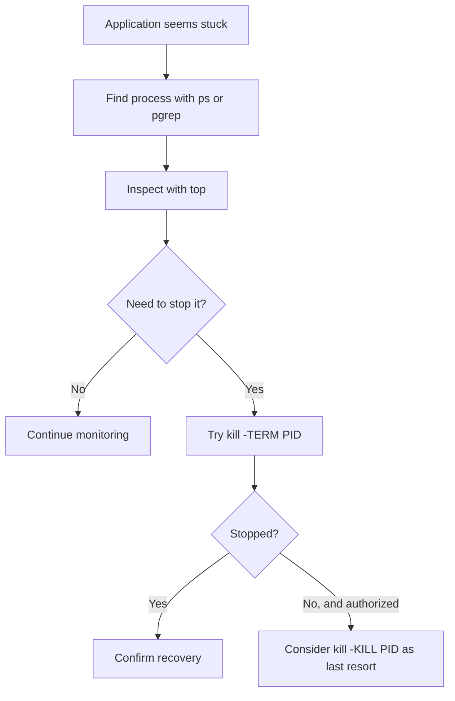


A process is a running program. Each process has a process ID (PID).

```bash
ps
ps aux
top
htop                 # Friendlier interactive process viewer; may need installation
pgrep -a nginx
```

-   `ps aux` lists many running processes.
-   `top` shows live process and resource usage; press `q` to quit.
-   `pgrep` searches for processes by name.

### Stop a process

```bash
kill PID
kill -TERM PID
kill -KILL PID
```

Replace `PID` with the real process ID. `TERM` requests a graceful stop;
`KILL` forcibly terminates a process and should be a last resort. Never
copy the word `PID` literally.

### Foreground and background jobs

```bash
sleep 60
```

Press `Ctrl+C` to interrupt it.

```bash
sleep 60 &
jobs
fg
```

-   `&` starts a command in the background.
-   `jobs` lists jobs in the current shell.
-   `fg` brings a job to the foreground.
-   `Ctrl+Z` suspends a foreground job; `bg` resumes it in the
    background.

`nohup command &` can keep a command running after logout in some
situations, but production workloads should normally be managed by a
service manager.

## 11. Services and logs

### Visual: diagnosing a failed service

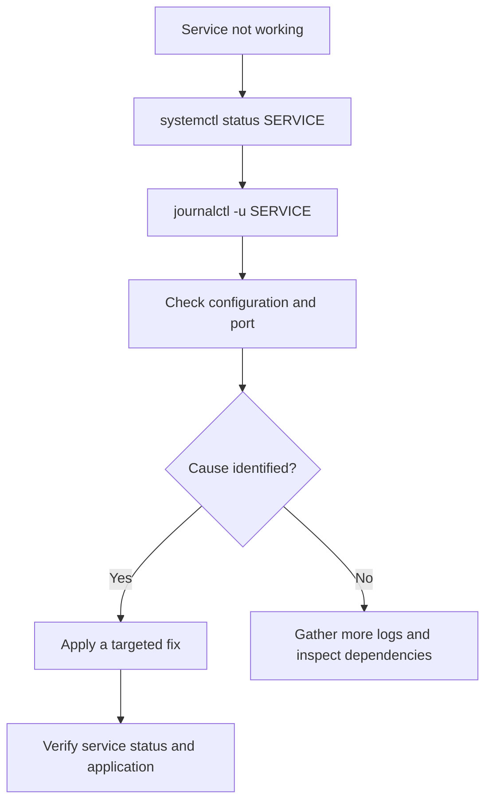


Many Linux distributions use `systemd`, but not all do.

### Check a service

```bash
systemctl status ssh
systemctl status sshd
```

Service names differ: Ubuntu commonly uses `ssh`; Amazon Linux and some
other distributions commonly use `sshd`.

```bash
sudo systemctl start ssh
sudo systemctl stop ssh
sudo systemctl restart ssh
sudo systemctl enable ssh
sudo systemctl disable ssh
```

Only start, stop, restart, enable, or disable services when you
understand the effect. Restarting SSH on a remote machine can interrupt
access if configuration is wrong.

### Read service logs

```bash
journalctl -u ssh --no-pager
journalctl -u ssh -n 50
journalctl -u ssh -f
journalctl -p err -b
```

-   `-u` filters by service.
-   `-n 50` shows the latest 50 entries.
-   `-f` follows new log entries; press `Ctrl+C` to stop.
-   `-p err` filters to error priority; `-b` limits to the current boot.

Common log locations vary by distribution:

```bash
ls /var/log
```

Examples include `/var/log/syslog`, `/var/log/messages`,
`/var/log/auth.log`, and `/var/log/secure`.

## 12. Networking and SSH

### Visual: basic network troubleshooting order

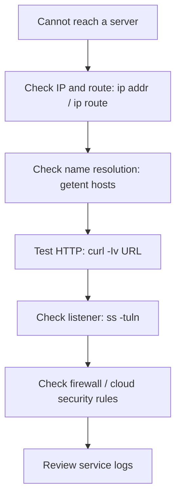


### Inspect network configuration

```bash
ip addr
ip route
hostname -I
dig example.com       # DNS lookup (install dnsutils/bind-utils if needed)
curl -I https://example.com # Fetch HTTP response headers
```

### Test connectivity and DNS

```bash
ping -c 4 8.8.8.8
getent hosts example.com
dig example.com
```

`ping` tests ICMP reachability, not whether a specific application port
is open. ICMP may be blocked even when a service works. `dig` may need
the `dnsutils` or `bind-utils` package.

### Test HTTP and ports

```bash
curl -I https://example.com
curl -sS https://example.com
ss -tuln
ss -tulpn
```

-   `curl -I` requests response headers.
-   `ss -tuln` lists listening TCP/UDP sockets with numeric
    addresses/ports.
-   Showing process details with `ss -p` may require elevated
    permissions.

### SSH and file transfer

```bash
ssh username@server-address
scp notes.txt username@server-address:/home/username/  # Copy local file to remote host
scp username@server-address:/home/username/notes.txt .  # Copy remote file to current directory
```

Create an SSH key pair:

```bash
ssh-keygen -t ed25519 -C "devops-lab"
```

Protect the private key (`~/.ssh/id_ed25519`) and never upload it to
GitHub. The public key (`~/.ssh/id_ed25519.pub`) is the one intended to
be shared with the server/account that should trust it.

For an EC2 instance, use the correct username for the AMI, the
instance's reachable address, the correct private key, and an authorized
security-group rule. Common usernames vary by image, for example
`ec2-user` or `ubuntu`.

## 13. Disk, memory, and system health

```bash
df -h             # Filesystem free/used space
du -sh directory  # Total size of a directory
du -h --max-depth=1 .  # Size of immediate subdirectories (GNU du)
lsblk             # Block devices and partitions
free -h           # RAM and swap
uptime            # Uptime and load averages
nproc             # Available processing units
```

If a disk is full:

1.  Check `df -h` to identify the full filesystem.
2.  Use `du -xhd1 /path` (where supported) to locate large directories
    on that filesystem.
3.  Inspect logs and application data before deleting anything.
4.  Do not delete files from `/var`, `/usr`, or application directories
    without understanding their purpose.

For a simple health check:

```bash
date
uptime
free -h
df -h
```

## 14. Packages and software installation

Package commands depend on the distribution.

### Ubuntu / Debian

```bash
sudo apt update
sudo apt install curl
sudo apt remove curl
```

`apt update` refreshes package metadata; it does not upgrade every
installed package.

### Amazon Linux / RHEL-family distributions

Depending on the version:

```bash
sudo dnf check-update
sudo dnf install curl
sudo dnf remove curl
```

Some systems use `yum` instead of `dnf`. Read package-manager output
before confirming changes, especially on production servers.

## 15. Bash scripting essentials

### Visual: how a Bash script runs

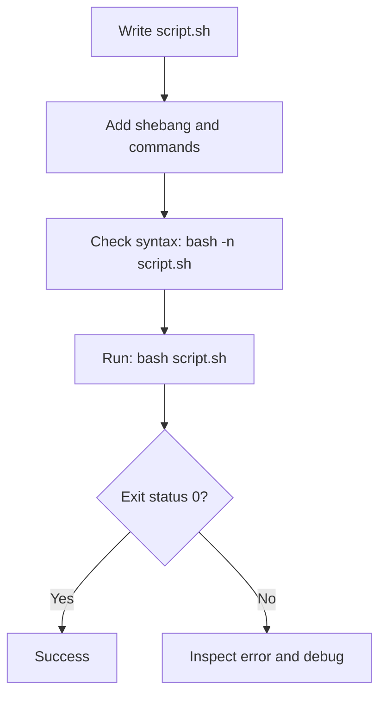


A script automates commands. Create `hello.sh`:

```bash
#!/usr/bin/env bash
set -euo pipefail

name="${1:-Student}"
echo "Hello, ${name}!"
date
```

Make it executable and run it:

```bash
chmod +x hello.sh
./hello.sh
./hello.sh Vahida
```

### Variables and command substitution

```bash
name="Linux"
echo "$name"
today="$(date +%F)"
echo "$today"
```

No spaces around `=` when assigning a shell variable. Quote variable
expansions in most cases to prevent accidental word splitting and
wildcard expansion.

### Conditions

```bash
#!/usr/bin/env bash
set -euo pipefail

file="notes.txt"

if [[ -f "$file" ]]; then
  echo "File exists"
else
  echo "File not found"
fi
```

Common tests:

-   `-f path` --- regular file exists.
-   `-d path` --- directory exists.
-   `-r path` --- readable.
-   `-w path` --- writable.
-   `-x path` --- executable or searchable, depending on file type.

### Loops

```bash
for file in *.log; do
  [[ -e "$file" ]] || continue
  echo "Found: $file"
done
```

### Exit status

```bash
curl -fsS https://example.com
echo "$?"
```

Exit status `0` conventionally means success; a non-zero status
indicates an error or other condition. `$?` must be checked immediately
because the next command changes it.

### Health-check script example

```bash
#!/usr/bin/env bash
set -uo pipefail

LOG_DIR="./logs"
LOG_FILE="$LOG_DIR/health.log"
mkdir -p "$LOG_DIR"

timestamp="$(date -Is)"
disk_used="$(df -P / | awk 'NR==2 {gsub("%","",$5); print $5}')"
memory_used="$(free | awk '/^Mem:/ {if ($2 > 0) printf "%.0f", ($3/$2)*100}')"

status="OK"

if [[ -z "$disk_used" || -z "$memory_used" ]]; then
  status="UNKNOWN"
elif (( disk_used >= 90 || memory_used >= 90 )); then
  status="WARNING"
fi

printf '%s status=%s disk_used_pct=%s memory_used_pct=%s\n' \
  "$timestamp" "$status" "${disk_used:-unknown}" "${memory_used:-unknown}" \
  | tee -a "$LOG_FILE"
```

Save as `check_health.sh`, then run:

```bash
chmod +x check_health.sh
./check_health.sh
cat logs/health.log
```

This is a learning example, not a full production monitoring agent.
Memory calculation can vary in meaning depending on the workload and the
metric used.

## 16. Environment variables, pipes, and redirection

### Visual: output redirection and pipes

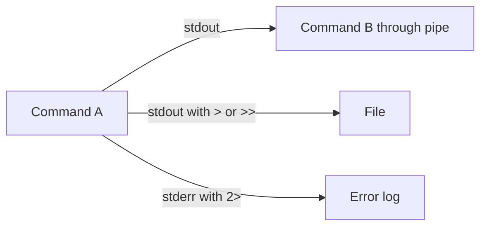

- `>` replaces a file's content.
- `>>` appends to a file.
- `2>` redirects error output.
- `|` sends one command's standard output into another command's standard input.


### Environment variables

```bash
echo "$HOME"
echo "$PATH"
export APP_ENV="dev"
printenv APP_ENV
```

`export` makes a variable available to child processes launched from
that shell. It does not automatically persist across new login sessions.

### Standard streams

-   `stdin` (file descriptor 0): input.
-   `stdout` (1): normal output.
-   `stderr` (2): error output.

```bash
ls > files.txt
ls >> files.txt
ls missing-path 2> errors.txt
ls /tmp > output.txt 2>&1
```

### Pipes

```bash
ps aux | grep nginx
journalctl -u ssh | grep -i error
cat app.log | grep "ERROR" | wc -l
```

The pipe sends one command's standard output to the next command's
standard input. For `grep`, `cat app.log | grep "ERROR"` can usually be
simplified to `grep "ERROR" app.log`.

## 17. Scheduling with cron

### Visual: cron job lifecycle

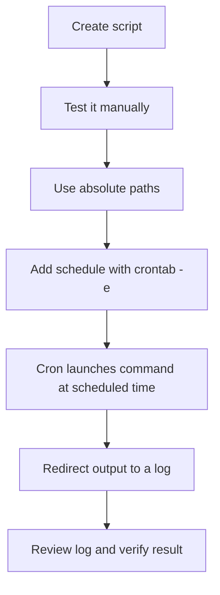


Cron runs commands on a schedule. Edit the current user's crontab:

```bash
crontab -e
crontab -l
```

Cron schedule format:

```text
minute hour day-of-month month day-of-week command
```

Example: run a script every day at 2:30 AM:

``` cron
30 2 * * * /home/username/scripts/backup.sh >> /home/username/backup.log 2>&1
```

Use absolute paths in cron jobs because the environment is usually
smaller than an interactive shell. Make sure the script is executable
and that the user has permission to access all paths. Test scripts
manually before scheduling them.

## 18. Common troubleshooting recipes

### A command says "Permission denied"

```bash
whoami
ls -l file
ls -ld directory
```

Check the file owner/group, permissions, directory traversal
permissions, and whether the action truly requires elevated access. Do
not reflexively use `chmod 777`.

### A service is not working

```bash
systemctl status SERVICE_NAME
journalctl -u SERVICE_NAME -n 100 --no-pager
ss -tuln
```

Replace `SERVICE_NAME` with the real service name. Check configuration
and logs before restarting.

### A website is unreachable

```bash
getent hosts example.com
curl -Iv https://example.com
ip route
```

Check DNS, routing, security groups/firewalls, the service listener, TLS
errors, and the destination address. A successful ping alone does not
prove the website works.

### Disk is full

```bash
df -h
du -xhd1 /var 2>/dev/null
```

Use `du` on a relevant directory and investigate before deleting files.

### A process uses too much CPU or memory

```bash
top
ps aux --sort=-%cpu | head
ps aux --sort=-%mem | head
```

Identify the process and understand what it does before stopping it.

## 19. Safe practice lab

Use a test VM or WSL environment. Complete these tasks and check your
work.

-   [ ] Create a directory named `linux-lab`.
-   [ ] Create five files using one `touch` command.
-   [ ] Create a text file using `cat >`, then append a line using
    `cat >>`.
-   [ ] Display the file with `cat`, `less`, `head`, and `tail`.
-   [ ] Inspect its timestamps using `stat`.
-   [ ] Create a `scripts` directory and a simple Bash script.
-   [ ] Set script permissions to `755`; set a normal text file to
    `644`.
-   [ ] Find a file by name using `find`.
-   [ ] Search for a word in a file using `grep -n`.
-   [ ] Inspect processes with `ps` and `top`.
-   [ ] Inspect disk and memory using `df -h` and `free -h`.
-   [ ] Inspect network addresses using `ip addr`.
-   [ ] On a disposable VM only, create two test users, set passwords,
    create a group, and add one user using `usermod -aG`.
-   [ ] Write a health-check script that records the date and disk
    usage.
-   [ ] Explain the difference between `>`, `>>`, and `2>` without
    looking at the notes.

## Infographic reference: command-by-command quick review

This section collects the exact command patterns highlighted in the companion Linux for DevOps cheat-sheet image.

### Navigation and directory commands

| Command | Purpose |
|---|---|
| `pwd` | Show the current directory |
| `ls` | List files |
| `ls -l` | Long-format listing |
| `ls -la` | Include hidden files in long format |
| `cd /` | Go to the root directory |
| `cd ..` | Go up one directory |
| `cd ~` | Go to your home directory |
| `mkdir dir` | Create a directory |
| `mkdir -p a/b/c` | Create nested directories |
| `rmdir dir` | Remove an empty directory |
| `find / -name "file.txt" 2>/dev/null` | Search from root; hide permission errors |
| `tree` | Display a directory tree, if installed |

### `cat` patterns from the cheat sheet

```bash
cat file.txt                         # View a file
cat > file.txt                       # Create/overwrite; type text, then Ctrl+D
cat >> file.txt                      # Append; type text, then Ctrl+D
cat file1.txt file2.txt > output.txt # Combine files into output.txt
```

**Caution:** `>` replaces existing content. `>>` appends. Check the target filename before using `>`.

### `touch` and file timestamps

```bash
touch file1.txt file2.txt file3.txt # Create multiple empty files / update their times
touch *.txt                         # Update times of matching .txt files in the current directory
touch -a file.txt                   # Update access time only
touch -m file.txt                   # Update modification time only
touch -c file.txt                   # Do not create it if missing
touch -t 202610121430 file.txt      # Set timestamp (YYYYMMDDhhmm)
stat file.txt                       # Inspect file timestamps and metadata
```

- **Access time (`atime`)**: when file content was last accessed, subject to filesystem policy.
- **Modification time (`mtime`)**: when file content was last modified.
- **Change time (`ctime`)**: when file metadata/inode status last changed; it is not a creation timestamp.

### User and group commands from the cheat sheet

```bash
sudo useradd -m -s /bin/bash john
sudo useradd -m -s /bin/bash alice
sudo useradd -m -s /bin/bash bob
sudo passwd john
sudo passwd alice
sudo passwd bob
sudo groupadd devops
sudo usermod -aG devops john
sudo usermod -aG devops alice
sudo usermod -aG devops bob
whoami
id
groups
```

On Ubuntu, `sudo adduser john` is also a friendly interactive option. Use `-aG` to append a supplementary group without replacing existing supplementary group memberships. Practice user administration only on a test machine where you have permission.

### Editors: Nano and Vim

| Nano shortcut | Action |
|---|---|
| `Ctrl+O` | Save (Write Out) |
| `Ctrl+X` | Exit |
| `Ctrl+W` | Search |
| `Ctrl+K` | Cut current line |

| Vim command | Action |
|---|---|
| `i` | Enter insert mode |
| `Esc` | Return to normal mode |
| `:w` | Save |
| `:q` | Quit if no unsaved changes |
| `:wq` | Save and quit |
| `:q!` | Quit without saving changes |
| `dd` | Delete line |
| `yy` | Copy/yank line |
| `p` | Paste |
| `/word` | Search for `word` |

### Permissions, ownership, processes, networking, and logs

```bash
ls -l script.sh                   # Inspect permissions
chmod 755 script.sh               # Owner rwx; group/others r-x
chmod 644 file.txt                # Owner rw; group/others read-only
sudo chown john file.txt          # Change owner
sudo chgrp devops file.txt        # Change group
sudo chown john:devops file.txt   # Change owner and group
ps aux                            # List processes
top                               # Live process/resource view
htop                              # Interactive view (may need installing)
systemctl status nginx            # Check service status (service name varies)
ip a                              # Show IP addresses
ping -c 4 example.com             # Test ICMP reachability
ss -tulnp                         # Inspect listening sockets
dig example.com                   # DNS lookup
curl -I https://example.com       # Check HTTP response headers
scp file.txt user@host:/path/     # Copy file over SSH
grep -i "error" file.log         # Search log text
find /var/log -name "*.log"      # Find log files
tail -f /var/log/syslog           # Follow a log if this path exists
df -h                             # Disk usage
free -h                           # Memory usage
```

`systemctl`, log paths, `htop`, and DNS tools vary by distribution. A successful `ping` does not prove an application port is open. In cloud environments, also check routing, firewalls, and security-group rules.

### Bash scripting and practice checklist

```bash
#!/usr/bin/env bash
name="${1:-Student}"
today="$(date +%F)"
echo "Hello, $name"
echo "Today is $today"
if [[ -f "file.txt" ]]; then
  echo "File exists"
else
  echo "File not found"
fi
```

Practice: create three users and add them to a group on a test VM; create 3–5 files with `touch`; use all four `cat` patterns; inspect timestamps with `stat`; change a test script to mode `755`; inspect a process; check disk/memory; write a simple Bash script; and review a log using `grep` and `tail`.

---

## 20. Quick command cheat sheet

  Goal                     Command
  ------------------------ ------------------------------------
  Current directory        `pwd`
  List files               `ls -lah`
  Create directory         `mkdir -p path/to/dir`
  Create multiple files    `touch a.txt b.txt c.txt`
  Display file             `cat file.txt`
  Append text              `cat >> file.txt`
  View the end of a log    `tail -n 50 app.log`
  Follow a log live        `tail -f app.log`
  Search text              `grep -n "ERROR" app.log`
  Find a file              `find . -name "file.txt"`
  Check identity           `whoami; id`
  Change permissions       `chmod 644 file.txt`
  Change owner/group       `sudo chown user:group file.txt`
  List processes           `ps aux`
  Check a service          `systemctl status SERVICE_NAME`
  View service logs        `journalctl -u SERVICE_NAME -n 50`
  Check listening ports    `ss -tuln`
  Check disk usage         `df -h`
  Check memory             `free -h`
  Check routes             `ip route`
  Test HTTP                `curl -I https://example.com`
  Run a script             `bash script.sh`
  Show current date/time   `date`

------------------------------------------------------------------------

## Final learning advice

Do not memorize commands without practicing. For each command,
understand:

1.  What it does.
2.  What each option means.
3.  Whether it only reads information or changes the system.
4.  What successful output looks like.
5.  How to troubleshoot an error safely.

**Suggested next topics after this guide:** Git and GitHub, AWS EC2,
IAM, security groups, Nginx, Docker, CI/CD, Terraform, and monitoring.
